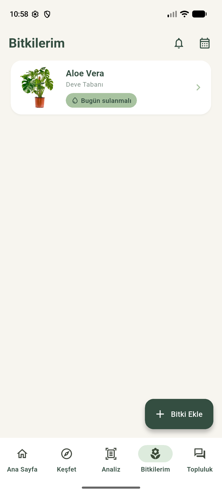

<p align="center">
  
</p>

<h1 align="center">BotanIQ</h1>

<p align="center">
  Yapay zekâ destekli bitki tanıma ve bakım asistanı<br/>
  <sub>Flutter · Dart · Material 3 · SQLite · Provider · Gemini API</sub>
</p>

| Ana Sayfa | Keşfet | Analiz | Bitkilerim | Topluluk |
|:---:|:---:|:---:|:---:|:---:|
|  |  |  |  |  |

## Özellikler

- 🔍 **Yapay zekâ analizi:** Fotoğraftan bitki türü ve sağlık değerlendirmesi (sararma, mantar, zararlı, sulama, besin eksikliği), önerilen bakım adımları
- 📚 **Bitki kütüphanesi:** 17 bitki, kategori filtresi, Türkçe arama, favoriler
- 🪴 **Bitkilerim:** Fotoğraflı kişisel koleksiyon; ekle, düzenle, sil
- 💧 **Sulama takibi:** Sonraki sulama hesabı, "Suladım" butonu, aylık takvim, yerel bildirimler
- 💬 **Topluluk:** Soru, deneyim ve ipucu gönderileri, yorumlar

## Teknik Yapı

- **Mimari:** `screens / widgets → providers → repositories → services` katmanları
- **Veri:** `sqflite` (sürüm geçişli şema), `shared_preferences`
- **Durum yönetimi:** `provider`
- **Yapay zekâ:** Gemini API; API anahtarı uygulamada değil, bir **Cloudflare Worker** proxy'sinde saklanır
- **Test:** 30'dan fazla birim ve widget testi (sahte repository'ler ve `MockClient` ile)

## Kurulum

```bash
git clone https://github.com/melekylby/botaniq.git
cd botaniq
flutter pub get
cp lib/config/api_config.example.dart lib/config/api_config.dart
flutter run
```

Analiz özelliği için `botaniq_proxy/worker.js` dosyasını bir Cloudflare Worker'a yükleyin, `GEMINI_API_KEY` ve `APP_TOKEN` gizli değişkenlerini ekleyin, Worker adresini `api_config.dart` dosyasına yazın. Diğer tüm özellikler proxy olmadan çalışır.

Testler: `flutter test --concurrency=1`

## Geliştirici

**Melek Yelbay** · [GitHub](https://github.com/melekylby) · [LinkedIn](https://www.linkedin.com/in/melekyelbay)

<sub>Yapay zekâ sonuçları tahmini değerlendirmedir, uzman görüşünün yerine geçmez.</sub>
