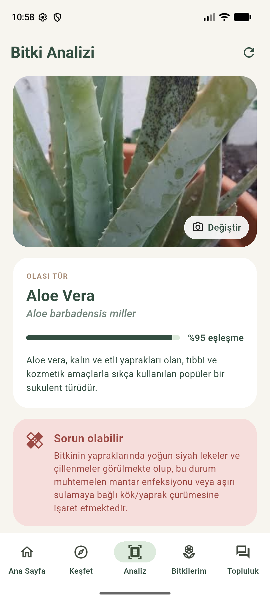
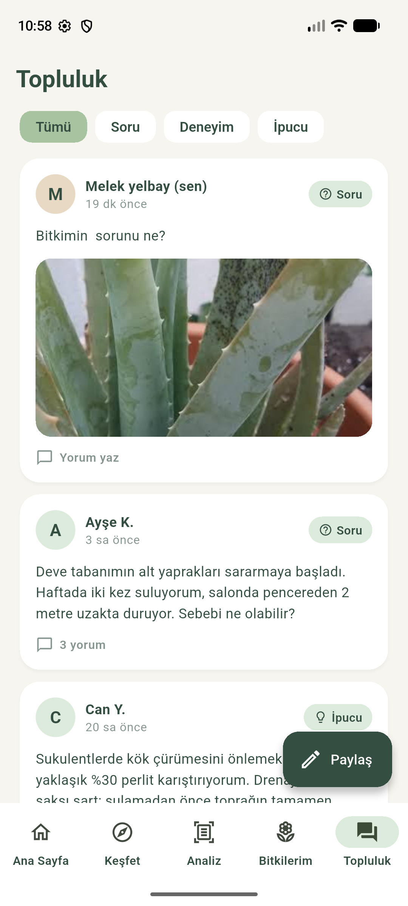
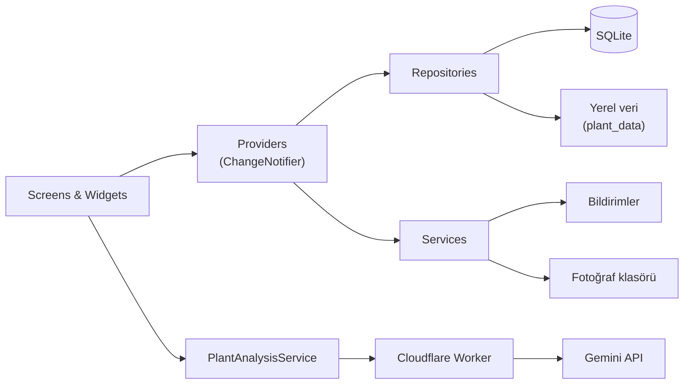
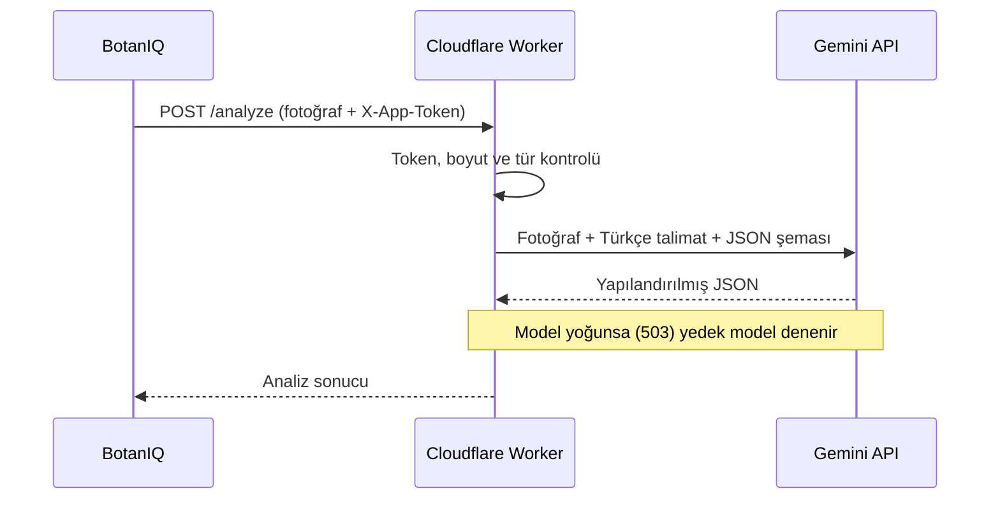

<p align="center">
  
</p>

<h1 align="center">BotanIQ</h1>

<p align="center">
  <b>Akıllı Bitki Tanıma ve Bakım Asistanı</b><br/>
  Flutter · Dart · Material 3 · SQLite · Provider · Gemini API
</p>

---

BotanIQ; bitkilerini fotoğrafla tanıyan, sağlık durumlarını yapay zekâ ile değerlendiren, sulama zamanlarını takip edip hatırlatan ve kullanıcıların deneyimlerini paylaşabildiği bir mobil uygulamadır.

Proje, bir üniversite mobil programlama dersi için dönem projesi olarak geliştirilmiştir. Hedef, **az sayıda ama eksiksiz, stabil ve iyi tasarlanmış özellik** sunmaktır.

## 📱 Ekran Görüntüleri

| Ana Sayfa | Keşfet | Bitki Analizi | Bitkilerim | Topluluk |
|:---:|:---:|:---:|:---:|:---:|
|  |  |  |  |  |

## ✨ Özellikler

### 🔍 Yapay Zekâ ile Bitki Tanıma ve Sağlık Analizi
- Kameradan çekilen ya da galeriden seçilen fotoğraftan **olası tür**, bilimsel ad ve eşleşme yüzdesi
- Yaprak sararması, kuruma, mantar, zararlı böcek, sulama hataları ve besin eksikliği için **sağlık değerlendirmesi**
- Her olası sorun için olasılık, açıklama ve **önerilen bakım adımları**
- Tanınan tür kütüphanede varsa bakım rehberine bağlantı; tek dokunuşla "Bitkilerime Ekle"
- Sonuçlar her zaman **tahmini değerlendirme** olarak sunulur; düşük güvende ek uyarı gösterilir

### 📚 Bitki Kütüphanesi
- 4 kategoride 17 bitki: iç mekân, dış mekân, sukulent, çiçekli
- Türkçe karakter duyarlı arama (ör. "PAŞA" → Paşa Kılıcı) ve kategori filtresi
- Işık, su, sıcaklık, nem bilgileri ve bakım ipuçları
- Kalıcı **favoriler**

### 🪴 Bitkilerim – Kişisel Koleksiyon
- Fotoğraflı bitki ekleme, düzenleme ve silme (SQLite)
- Kütüphaneden tür seçilince önerilen sulama aralığı otomatik gelir
- Kişisel bakım notları

### 💧 Sulama Takibi ve Hatırlatmalar
- Bir sonraki sulama tarihinin otomatik hesaplanması; gecikmiş, bugün ve yaklaşan durumlar için renkli etiketler
- Ana sayfada önümüzdeki 3 günün görevleri ve tek dokunuşla **"Suladım"** (geri alınabilir)
- Aylık **bakım takvimi**
- Sulama günü saat 09:00'da **yerel bildirim**

### 💬 Topluluk
- Soru, deneyim ve ipucu türünde gönderiler (isteğe bağlı fotoğraflı)
- Yorumlar, tür filtresi ve kendi gönderini silme

### 🌿 Diğer
- Her gün değişen **Günün Bitkisi**
- Pastel botanik Material 3 teması ve Türkçe sistem metinleri (takvim, tarih seçici)

## 🛠️ Kullanılan Teknolojiler

| Alan | Teknoloji |
|---|---|
| Arayüz | Flutter, Material 3 |
| Durum yönetimi | `provider` (ChangeNotifier) |
| Yerel veritabanı | `sqflite` (sürüm geçişli şema) |
| Küçük tercihler | `shared_preferences` |
| Fotoğraf | `image_picker`, `path_provider` (kalıcı klasöre kopyalama) |
| Bildirimler | `flutter_local_notifications`, `timezone` |
| Ağ | `http` |
| Yapay zekâ | Google Gemini API (yapılandırılmış JSON çıktısı) |
| Sunucu | Cloudflare Workers (API anahtarını gizleyen proxy) |
| Test | `flutter_test`, `http/testing` (MockClient), sahte repository'ler |

## 🏗️ Mimari

Proje, katmanları birbirinden ayıran ama gereksiz karmaşıklık içermeyen bir yapı kullanır:



- **Screens / Widgets:** Yalnızca arayüz. Tekrar kullanılan parçalar `widgets/` altında.
- **Providers:** Birden fazla ekranın paylaştığı durum (favoriler, bitkilerim, topluluk). Yalnızca tek ekranı ilgilendiren durum (ör. arama metni) ekranın kendi `State`'inde tutulur.
- **Repositories:** Veri kaynağına erişimin tek kapısı. SQL sorguları yalnızca burada bulunur. Topluluk ileride Firebase'e taşınırsa sadece repository değişir.
- **Services:** Veritabanı bağlantısı, fotoğraf saklama, bildirimler, sulama hesapları ve yapay zekâ isteği.

```
lib/
├── main.dart
├── config/         # Proxy adresi (git'e yüklenmez)
├── data/           # Bitki kütüphanesi ve örnek gönderiler
├── models/         # Plant, MyPlant, Post, Comment, AnalysisResult
├── providers/      # Favorites, MyPlants, Community
├── repositories/   # Plant, MyPlant, Community
├── screens/        # Her ekran ayrı dosyada
├── services/       # Database, Photo, Notification, WateringSchedule, Analysis
├── theme/          # Renkler ve Material 3 teması
├── utils/          # Tarih biçimlendirme
└── widgets/        # Tekrar kullanılan bileşenler
botaniq_proxy/      # Cloudflare Worker kodu
```

### Yapay zekâ akışı ve API anahtarı güvenliği

API anahtarı mobil uygulamaya **gömülmez**. Uygulama fotoğrafı küçük bir Cloudflare Worker'a gönderir; anahtar yalnızca Worker'ın gizli değişkenlerinde durur.



> `X-App-Token` gerçek bir kimlik doğrulama değildir; yalnızca proxy'ye rastgele erişimi zorlaştırır. Üretim ortamında bunun yerine kullanıcı girişi (ör. Firebase Authentication) kullanılmalıdır.

## 🚀 Kurulum

### Gereksinimler
- Flutter (3.38 veya üstü) ve Android Studio
- Android 7.0 (API 24) veya üstü bir cihaz ya da emülatör
- Google AI Studio API anahtarı ve ücretsiz bir Cloudflare hesabı (yalnızca analiz özelliği için)

### 1. Projeyi çalıştır
```bash
git clone https://github.com/melekylby/botaniq.git
cd botaniq
flutter pub get
cp lib/config/api_config.example.dart lib/config/api_config.dart
flutter run
```
Analiz dışındaki tüm özellikler proxy kurulmadan da çalışır.

### 2. Analiz proxy'sini kur (isteğe bağlı)
1. [Google AI Studio](https://aistudio.google.com) üzerinden bir API anahtarı oluştur.
2. Cloudflare panelinde yeni bir Worker oluştur ve `botaniq_proxy/worker.js` içeriğini yapıştırıp yayınla.
3. Worker ayarlarında iki **Secret** ekle:
   - `GEMINI_API_KEY`: Google AI Studio anahtarı
   - `APP_TOKEN`: rastgele bir kod (`openssl rand -hex 16`)
4. `lib/config/api_config.dart` dosyasına Worker adresini ve `APP_TOKEN` değerini yaz.

İsteğe bağlı değişkenler: `GEMINI_MODEL`, `GEMINI_FALLBACK_MODEL`.

## 🧪 Testler

```bash
flutter test --concurrency=1
```

30'dan fazla birim ve widget testi; veritabanı ve ağ, sahte repository'ler ve `MockClient` ile taklit edilir. Bu sayede testler cihaz, internet ya da API kotası gerektirmez. Kapsanan başlıca konular:

- Türkçe arama, kategori filtresi, günün bitkisi ve bilimsel ad eşleştirme
- Sulama planı: sonraki tarih, gecikmiş bitkiler, takvim günleri, hatırlatma saati
- Bitki, gönderi ve yorum ekleme/güncelleme/silme
- Yapay zekâ cevabının güvenli okunması ve hata mesajları

## 🧭 Tasarım Kararları

- **Yerel önce:** Kütüphane, koleksiyon ve topluluk internet olmadan çalışır; canlı sunumda bağlantı sorunlarından etkilenmez.
- **Fotoğraflar** uygulamanın kalıcı klasörüne kopyalanır; veritabanında tam yol yerine yalnızca dosya adı tutulur.
- **Veritabanı sürümleme:** Topluluk tabloları `onUpgrade` ile eklendi; mevcut kullanıcı verisi korunur.
- **Bildirimler** "inexact" planlanır: dakika hassasiyeti gerekmez ve ek izin istemez.
- **Hata yönetimi:** Her ağ ve veritabanı hatası kullanıcıya Türkçe, anlaşılır bir mesajla gösterilir; uygulama çökmez.

## 🔮 Gelecek Planları
- Bitki sağlık geçmişi (aynı bitkinin farklı tarihlerdeki analizleri)
- Firebase ile gerçek kullanıcı hesapları ve paylaşılan topluluk
- Mevsimsel bakım ipuçları
- iOS desteği

## 👤 Geliştirici

**Melek Yelbay** · [GitHub](https://github.com/melekylby) · [LinkedIn](https://www.linkedin.com/in/melekyelbay)

> Yapay zekâ analiz sonuçları tahmini değerlendirmelerdir ve uzman görüşünün yerine geçmez.
