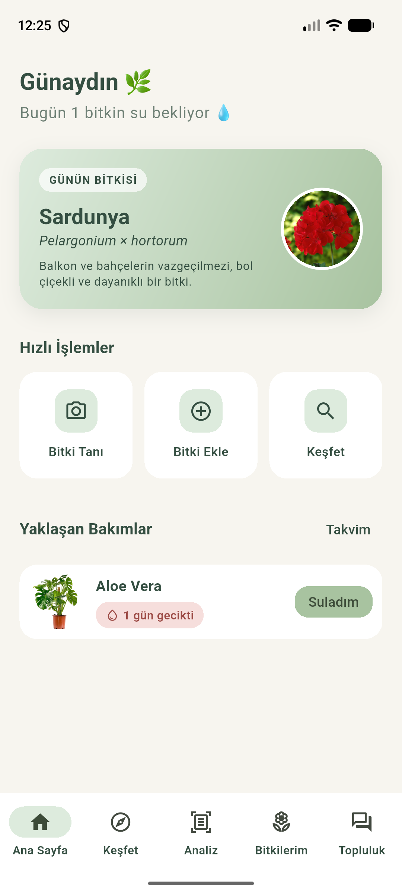
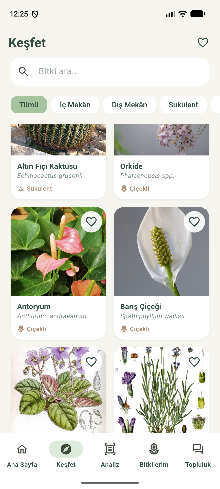

<p align="center">
  
</p>

<h1 align="center">BotanIQ</h1>

<p align="center">
  Yapay zekâ destekli bitki tanıma ve bakım asistanı<br/>
  <sub>Flutter · Dart · Material 3 · SQLite · Provider · Gemini API</sub>
</p>

| Ana Sayfa | Keşfet | Analiz | Bitkilerim | Topluluk |
|:---:|:---:|:---:|:---:|:---:|
|  |  |  |  |  |

## Özellikler

- Yapay zekâ analizi: fotoğraftan bitki türü tahmini ve sağlık değerlendirmesi (sararma, mantar, zararlı, sulama ve besin eksikliği belirtileri) ile önerilen bakım adımları
- Bitki kütüphanesi: 17 bitki, kategori filtresi, Türkçe arama ve favoriler
- Bitkilerim: fotoğraflı kişisel koleksiyon; ekleme, düzenleme ve silme
- Sulama takibi: sonraki sulama tarihi, "Suladım" butonu, aylık takvim ve yerel bildirimler
- Topluluk: soru, deneyim ve ipucu gönderileri, yorumlar

## Teknik Yapı

- Mimari: `screens / widgets → providers → repositories → services`
- Veri: `sqflite` (sürüm geçişli şema), `shared_preferences`
- Durum yönetimi: `provider`
- Yapay zekâ: Gemini API. API anahtarı uygulamada değil, bir Cloudflare Worker proxy'sinde saklanır.
- Test: 30'dan fazla birim ve widget testi (sahte repository'ler ve `MockClient` ile)

## Kurulum

```bash
git clone https://github.com/melekylby/botaniq.git
cd botaniq
flutter pub get
cp lib/config/api_config.example.dart lib/config/api_config.dart
flutter run
```

Analiz özelliği için `botaniq_proxy/worker.js` dosyasını bir Cloudflare Worker'a yükleyip `GEMINI_API_KEY` ve `APP_TOKEN` gizli değişkenlerini ekleyin, ardından Worker adresini `api_config.dart` dosyasına yazın. Diğer özellikler proxy olmadan da çalışır.

Testleri çalıştırmak için: `flutter test --concurrency=1`

## Geliştirici

Melek Yelbay · [GitHub](https://github.com/melekylby) · [LinkedIn](https://www.linkedin.com/in/melekyelbay)
